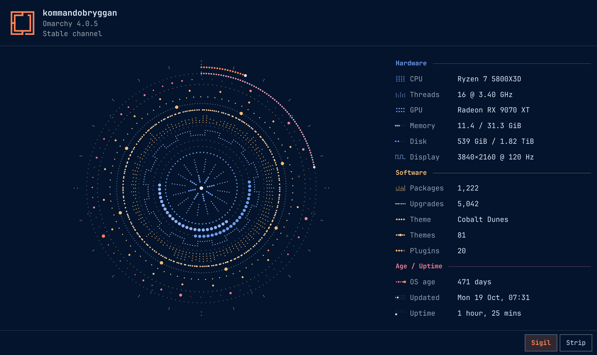

# Machine Mark

Omarchy's About window as a sigil drawn from your machine's real specs, every mark made of round dots. Every ring is one fact about the computer, and you can knead the whole thing into a strip of rows and back.



- **Hardware** (blue): a short line of dots per CPU core, a line of dots per thread, a dot per block of GPU shader cores (128 on NVIDIA, a compute unit on AMD, 8 execution units on Intel), memory and disk as rows of large dots, a pulse per 10 Hz of the display.
- **Software** (yellow): a line of dots per 10 packages in the order they were last installed or upgraded, taller for the ones that take more disk, a short run of dots per 40 upgrades in pacman's log, 8 dots standing for your theme's terminal colours, a dot per installed theme, a dot per plugin (faint when it's off).
- **Age / Uptime** (pink): a dot per week since install, bigger for the weeks you upgraded more, a one-week dial for the time since the last update, and a 24-hour dial for uptime.

On a big or old machine a ring that would crowd gets coarser: a line per 4 cores, a run per 200 upgrades, a dot per 2 weeks. Hover a ring and the footer says what each mark stands for.

The colours come from your current Omarchy theme and change with it. Thread lengths, upgrade runs and ring angles come from a seed of the hostname and hardware, so every machine gets its own shape. In the sigil the rings turn slowly and the display's pulses travel round; the strip stands still.

## Install

```bash
omarchy plugin add https://github.com/erikrjohansson/omarchy-machine-mark.git --enable
```

It opens as a normal floating window, like Omarchy's own About, so you can move it anywhere. Open it with:

```bash
omarchy-shell shell summon io.github.erikrjohansson.machine-mark '{}'
```

To open it from **Super + Space → About** instead of the terminal version, add this line inside `~/.config/omarchy/extensions/omarchy-menu.jsonc`:

```jsonc
"about": {"icon":"","label":"About","action":"[[ $(omarchy-shell shell summon io.github.erikrjohansson.machine-mark '{}' 2>/dev/null) == ok ]] || omarchy-launch-about"},
```

If the plugin is switched off or removed, the line opens the original About instead.

## Remove

```bash
omarchy plugin remove io.github.erikrjohansson.machine-mark
```

If you added the About line to `~/.config/omarchy/extensions/omarchy-menu.jsonc`, delete it as well. Left in, it simply opens the original About.

## Use

| | |
|---|---|
| Drag sideways, click, <kbd>Space</kbd> | knead between sigil and strip |
| <kbd>←</kbd> <kbd>→</kbd> | sigil / strip (drag right to unroll the sigil into the strip) |
| <kbd>↑</kbd> <kbd>↓</kbd>, hover | pick a ring; the footer shows a detail about it |
| <kbd>Esc</kbd>, <kbd>Super</kbd> + <kbd>W</kbd> | close |

## What it reads

The `machine-mark` helper only reads: it changes no settings and writes no files of its own. It reads:

- `fastfetch` (CPU, GPU, memory, disk, display, packages, kernel, Hyprland)
- `/var/log/pacman.log` (upgrades in the log, per week, and the time of the last one)
- pacman's package database in `/var/lib/pacman/local` (each package's install date and size)
- the root filesystem's creation time (the install date, as Omarchy's own About estimates it)
- the theme folders in Omarchy and `~/.config/omarchy/themes` (how many, and which is current)
- the shell's plugin list (the plugins you added, and which are on)
- `omarchy-version`, `omarchy-version-channel`, `omarchy-theme-current`

It reads once a few seconds after the shell starts and again after a theme switch, so About opens with the facts ready. While the window is open it reads memory, GPU load and uptime again every 4 seconds. Nothing leaves the machine. If `fastfetch` or `jq` is missing the window says so; facts fastfetch doesn't report show as "unknown".

## Requirements

Omarchy 4 (Quickshell shell), `fastfetch`, `jq`, `gawk` (part of every Arch install).

## License

MIT
