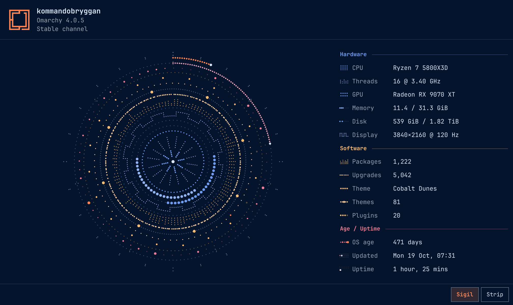

# Machine Mark

Omarchy's About window as a sigil drawn from your machine's real specs, every mark made of round dots. Every ring is one fact about the computer, and you can knead the whole thing into a strip of rows and back, a different way each time: it bursts, weaves, reels, spins like a coin, rings out like a harp or breaks like a cue ball.



- **Hardware** (blue): a short line of dots per CPU core, a line of dots per thread, a dot per block of GPU shader cores (128 on NVIDIA, a compute unit on AMD, 8 execution units on Intel), memory and disk as rows of large dots, a pulse per 10 Hz of the display: a ring of its own for each display, up to 8, a laptop's built-in screen first.
- **Software** (yellow): a line of dots per 10 packages in the order they were last installed or upgraded, taller for the ones that take more disk, a short run of dots per 40 upgrades in pacman's log, 8 dots standing for your theme's terminal colours, a dot per installed theme, a dot per plugin (faint when it's off).
- **Age / Uptime** (pink): a dot per week since install, bigger for the weeks you upgraded more, on a laptop the battery's health (how much it holds against how much it held new) as a row of large dots, a one-week dial for the time since the last update, and a 24-hour dial for uptime.

The header names the machine: its hostname, then its make and model as the firmware gives them ("Lenovo ThinkPad X1 Carbon Gen 9"), left out where the firmware has only a placeholder.

On a big or old machine a ring that would crowd gets coarser: a line per 4 cores, a run per 200 upgrades, a dot per 2 weeks. Hover a ring and the footer says what each mark stands for.

The colours come from your current Omarchy theme and change with it. Thread lengths, upgrade runs and ring angles come from a seed of the hostname and hardware, so every machine gets its own shape. In the sigil the rings turn slowly and the display's pulses travel round; the strip stands still.

## Install

```bash
omarchy plugin add https://github.com/erikrjohansson/omarchy-machine-mark.git --enable
```

It opens as a normal floating window, like Omarchy's own About, so you can move it anywhere. Open it with:

```bash
omarchy-shell shell summon io.github.erikrjohansson.machine-mark '{}'
```

To open it from **Super + Space → About** instead of the terminal version, add this line inside `~/.config/omarchy/extensions/omarchy-menu.jsonc`:

```jsonc
"about": {"icon":"","label":"About","action":"[[ $(omarchy-shell shell summon io.github.erikrjohansson.machine-mark '{}' 2>/dev/null) == ok ]] || omarchy-launch-about"},
```

If the plugin is switched off or removed, the line opens the original About instead.

## Remove

```bash
omarchy plugin remove io.github.erikrjohansson.machine-mark
```

If you added the About line to `~/.config/omarchy/extensions/omarchy-menu.jsonc`, delete it as well. Left in, it simply opens the original About.

## Use

| | |
|---|---|
| Drag sideways, click, <kbd>Space</kbd> | knead between sigil and strip |
| <kbd>←</kbd> <kbd>→</kbd> | sigil / strip (drag right to unroll the sigil into the strip) |
| <kbd>↑</kbd> <kbd>↓</kbd>, hover | pick a ring; the footer shows a detail about it |
| <kbd>1</kbd>–<kbd>6</kbd>, <kbd>0</kbd> | keep to one way of kneading; 0 for a random one each time again |
| **Copy** (top right) | copy everything shown, as plain text, to paste anywhere |
| <kbd>Esc</kbd>, <kbd>Super</kbd> + <kbd>W</kbd> | close |

## What it reads

The `machine-mark` helper only reads: it changes no settings and writes no files of its own. It reads:

- `fastfetch` (make and model, CPU, GPU, memory, disk, display, packages, kernel, Hyprland)
- the battery in `/sys/class/power_supply` (how much it holds now and new, and its charge cycles where it counts them; a mouse's or keyboard's battery is left out)
- `/var/log/pacman.log` (upgrades in the log, per week, and the time of the last one)
- pacman's package database in `/var/lib/pacman/local` (each package's install date and size)
- the root filesystem's creation time (the install date, as Omarchy's own About estimates it)
- the theme folders in Omarchy and `~/.config/omarchy/themes` (how many, and which is current)
- the shell's plugin list (the plugins you added, and which are on)
- `omarchy-version`, `omarchy-version-channel`, `omarchy-theme-current`

It reads once a few seconds after the shell starts and again after a theme switch, so About opens with the facts ready. While the window is open it reads memory, GPU load and uptime again every 4 seconds. Nothing leaves the machine. If `fastfetch` or `jq` is missing the window says so; facts fastfetch doesn't report show as "unknown".

## Requirements

Omarchy 4 (Quickshell shell), `fastfetch`, `jq`, `gawk` (part of every Arch install), `wl-clipboard` for the Copy button (part of Omarchy).

## Changes

### 17 November 2026: copy it all

- **A Copy button, top right.** It puts everything the window shows onto the clipboard as plain text, to paste into a file, a chat or a bug report: the hostname with the make and model, the Omarchy version, channel, kernel and Hyprland, then each section's rows as the list has them, names lined up. A display's row names the display too ("2560×1440 @ 144 Hz (LG 27GL850)"). The footer says when it's copied.

### 17 November 2026: make and model, and battery health

- **Make and model in the header.** Next to the hostname, softer, the machine's make and model as its firmware gives them: "Lenovo ThinkPad X1 Carbon Gen 9", "Framework Laptop 13". Vendor names are tidied ("Dell Inc." reads "Dell", "ASUSTeK COMPUTER INC." reads "ASUS"); where the firmware has only a placeholder, as many desktop boards do ("System Product Name", "To Be Filled By O.E.M."), it is left out.
- **A Battery ring, on laptops.** In the Age / Uptime section, after OS age: how much the battery holds now against how much it held new, as a row of large dots that fills that far. The list gives it in Wh ("45.2 / 57.0 Wh (79%)"), the strip as a percentage ("79% health"), and hovering it says the charge cycles too where the battery counts them. A machine with more than one battery adds them up; a mouse's or keyboard's battery is left out. Without a battery there is no ring and the sigil is as it was; the Age section's rings get a little thinner to make room for it otherwise.

### 17 November 2026: the disk in whole numbers

- **Disk, in the list.** Used and total are both whole GiB ("312 GiB / 931 GiB" rather than "312 GiB / 931.51 GiB"), a big disk too ("1,240 GiB / 1,863 GiB"), so the two always read the same way. The strip's short value was already whole and is unchanged.

### 17 November 2026: every display, not just the largest

The window used to show only the largest display; now it shows them all, as Omarchy's own About does.

- **A ring and a row per display.** Each display gets its own Display ring in the sigil and its own row in the list and the strip: Display 1, Display 2, Display 3 and so on, each with its resolution and refresh rate, and each ring pulsing at its own rate. A laptop's built-in screen always comes first; the rest follow in the order About lists them. Up to 8 displays get a ring.
- **The other hardware rings make room.** With more than one display, the CPU, threads, GPU, memory and disk rings get thinner in proportion, so the hardware section stays the same size. The rest of the machine's shape stays as it was.
- **Hover names the display.** With several, the footer says which one a ring is, by its name ("Your 27″ LG 27GL850 runs at 144 Hz"), and says when it is the built-in one.
- **Plugging a display in or out.** If the number of displays changes while the window is open, the sigil builds in again with the new rings.
- **Every way of kneading works with any number of rings.** Loom, Spool, Coin, Harp and Break shot no longer assume a fixed number of rings; Loom weaves an odd number of passes, giving the top passes one row each where the rings don't pair up.
- **One display looks as it did.** With a single display the ring is still called Display and the sigil is the same as before.

The `machine-mark` helper now lists every display under `displays` (name, type, resolution, refresh rate, size). `display` is still there, as the first of them.

## License

MIT
